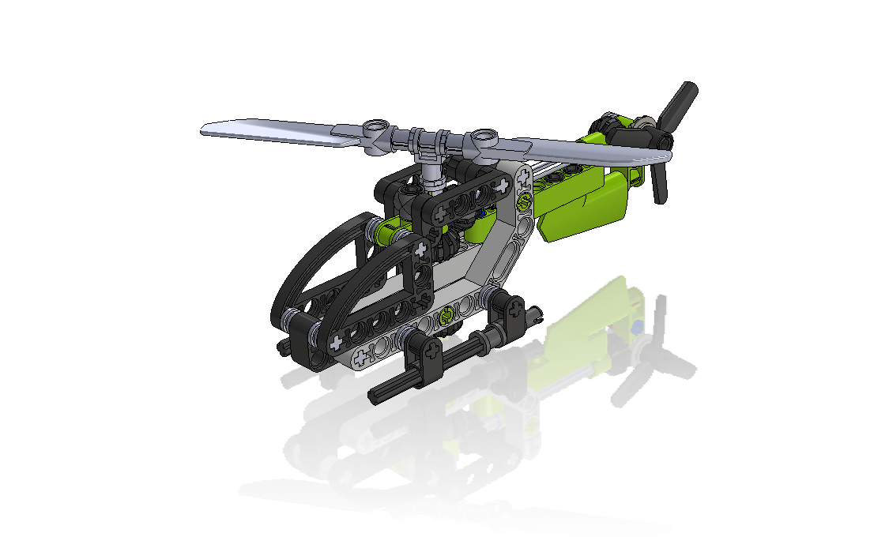

# ReStart

**Repair, don't recycle it twice.** A browser repair manual for the LEGO Technic helicopter
30465 that finds the *least destructive* way to replace one specific piece — and shows its work.

Built for the **Healthcare Hackathon 2026**, challenge *"From CAD to Circular: AI-Based
Disassembly Analysis for MedTech"* by Siemens Healthineers
([brief](assets/siemens-provided/OnePager.pdf)).

<p align="center">
  
</p>

## The idea

A mechanic selects **the particular physical piece** that needs replacing — one of 70
occurrences, including an internal gear or one of several identical pins. ReStart shows which
parts obstruct it, plays an animated manual through **removal → replacement → restoration →
function check**, and reports what evidence backs that exact procedure.

The product loop is the reason to *minimize* disassembly. A successful repair returns a
working assembly to service and documents which healthy pieces and functional units it
preserved. A helicopter repair that removes eleven parts when four would do wastes the parts
you might reuse.

```
STEP + BoM + timing lookup ──► geometry & identity ──► reviewed dependency graph
                                                            │
     static HTTPS bundle ◄── precomputed routes & manuals ◄──┘
            │
   React manual + Three.js view        local reviewer (planner in a worker)
```

## What the release has to do

| Gate | Bar |
|---|---|
| Coverage | **70/70** single-target repairs load, replay through replacement and restoration, and trace to the reviewed graph |
| Physical | **3** representative repairs completed on the real kit by an uncoached operator who did not author the procedure |
| Objective | Minimize *distinct non-target healthy pieces disturbed*, with an honest proof status |
| Delivery | Hosted URL, works on Windows with no installation, no sign-in, no CAD, no STEP upload |
| Design | A designer can restyle the UI without touching behaviour |

Evidence tiers are kept distinct and are never conflated: *generated* → *team-reviewed* →
*replayed against model* → *minimum under the reviewed model* → *physically verified*.

## Repository layout

```
assets/siemens-provided/                 challenge inputs (read-only)
  OnePager.pdf                             the brief
  BoM_Helicopter_LEGO.xlsx                 70 component rows, hierarchy, mass, functional units
  Components.xlsx                          31 inventory rows summing to 70 pieces
  MTM_Mapping_Connection_V3.xlsx           EN/DE connection classes and fictitious MTM times
  Provisions on Participation_*.pdf        participation and IP terms
assets/lego-helicopter-30465-1.snapshot.9/  reference assembly (read-only)
  STEP File Assembly - ... .STEP           AP203 assembly, ~6.9 MB
  SOLIDWORKS files/                        part and stage assemblies
  Instructions - Lego Helicopter 30465.*   the 22-stage illustrated sheet
docs/plans/0.1.0/                        the plan set
  01-software-design-plan.md               product decisions, architecture, evidence meaning
  02-software-design-implementation-plan.md handoff, tickets, 48-hour schedule, commands
  03-software-verification-plan.md         V01–V10 acceptance matrix and run order
docs/progress/                            one screenshot folder per commit (plan 02 §8)
src/                                      the app, bootstrapped at the repository root
  domain/                                 assembly state, graph, search, replay, evidence — pure TS
  app/                                    loaders, session controller, view-model selectors, adapters
  presentation/                           typed view models, screens, `tokens.css`
  scene/ graph-view/                      Three.js and graph render adapters (IDs back to the app)
  concept/                                development gallery at `#/concept` over the same screens
tools/{import,compile,verify}/            build-side STEP + workbook import, batch verification
tools/lib/                               STEP parse, assembly tree, tessellation, crosswalk, GLB
tools/progress/                           pre-commit capture tool and its PNG difference metric
data/review/                              versioned crosswalk decisions, motion evidence, bench records
public/models/30465/                      the published content-hashed dataset (manifest, GLB, graphs, manuals)
tests/{data,domain,geometry,ui,review,integration,release}/  Vitest suites
```

Layer boundaries are enforced, not conventional: `domain` imports nothing browser- or
CAD-side, and planner, storage, fetch, import and renderer calls live in their designated
adapters. See [AGENTS.md](AGENTS.md).

**Current status:** the toolchain from
[implementation plan §1](docs/plans/0.1.0/02-software-design-implementation-plan.md) is
bootstrapped and green — pinned dependencies, strict TypeScript, the Vite app shell, the
instruction-sheet design tokens, and Vitest with a Node default and jsdom for DOM suites.
Built since: the STEP importer expands the pinned snapshot into **70 placed occurrences**,
tessellates them, matches every occurrence to its own mesh (**70/70**, lowest winning score
0.9912) and writes a GLB with one pickable node per occurrence ID; the three supplied workbooks
join those occurrences — 31 inventory rows summing to 70, a 70-row bill of materials and a
62-row timing lookup — with two reconciliation findings recorded in
[RV-002](data/review/source-joins.md); the importer reads the cylindrical interface faces of
every part definition, because that is where a piece's removal axis comes from — **1,295
cylinders over the 31 definitions, 64 candidate travel axes**, every face named by its STEP
entity and carried in the definition's own coordinates, since part frames are not
assembly-aligned ([RV-003](data/review/interface-features.md)); the repair model, state
transitions, replay and metrics
are pure `src/domain/`; and the planner minimises *distinct healthy pieces disturbed* while
reporting one of four honest statuses
(`proved-minimum`, `best-route-found`, `search-incomplete`, `no-feasible-route`), where
`lowerBound` bounds the **optimum** — never above a job the search itself returned — and
equal-count tie enumeration is reported separately from the proof
([plan §4.7 addendum](docs/plans/0.1.0/02-software-design-implementation-plan.md)). The search
is checked against an exhaustive oracle that re-derives legality, cost and the complete-job
goal from hand-worked fixtures, plus three mutation faults an oracle must be able to catch.
and the swept-volume clearance primitive the automatic graph is generated from
(`tools/lib/sweep.ts`), which tests every interval between two sampled frames instead of
trusting the sample grid: a 0.4 mm obstruction sitting between 1 mm samples is still reported as
a hit, while a stroke through the empty corner of a concave neighbour is still clear — the two
failure modes that would respectively delete a step from a manual or tell a mechanic to strip
healthy parts for nothing.
Not built yet: the move and constraint generator that consumes it, the mechanic and reviewer
screens, the Three.js scene, the reviewer, and the 70-target `model:compile` / `model:verify`
batch.
Plan §1 records the measured STEP-import baseline the remaining tickets must reproduce.

**The screens are not built, and the progress trail now says so instead of implying
otherwise.** `#/`, `#/review` and `#/concept` all render one shared placeholder component with
different wording, so their screenshots look like three screens while the application is one
card; Tickets 4 and 8 replace it. Each capture now records the *layout identity* of the screen
it rendered and whether that screen is still a placeholder, so a capture set made entirely of
placeholders is refused rather than filed as progress
([plan §8.2](docs/plans/0.1.0/02-software-design-implementation-plan.md)).
A commit with nothing to render no longer files a stub as progress either: it photographs its
own measured output instead ([plan §8.3](docs/plans/0.1.0/02-software-design-implementation-plan.md)).

## The assembly, as measured

| | |
|---|---|
| STEP SHA-256 | `e15deb431d0ece9baf411cec7612f00d1a49e3e536ea183893b6792f6dfc7588` |
| Structure | 1 root, 13 assembly definitions, 31 distinct leaf definitions, 81 usage records |
| Physical pieces | **70 expanded leaf occurrences**, identified by their usage-ID path from the root |
| Tessellation | `occt-import-js@0.0.23`, mm, linear deflection 0.12, angular 0.4 → 70 meshes over 37 mesh-bearing nodes, **48,874 triangles** |
| Shipped geometry | one GLB node per occurrence ID, source axes preserved, mm → m at build time |
| Identity check | usage paths matched to transformed B-rep vertices: **70/70**, lowest winning vertex-match fraction 0.9912 |
| Witnesses | Stage 1 axle `NAUO1/NAUO79` bounds centre ≈ `[0, 0, 32]` mm; both rotor blades centre at Y ≈ 47.5 mm |
| Inventory | 31 part types whose quantities sum to the sheet's own total of 70, matched to STEP names 31/31 ([RV-002](data/review/source-joins.md)) |
| Bill of materials | 70 rows, same multiset of pieces as the assembly but only 7 positions aligned, so 54 rows join at type level and are marked ambiguous |
| Timing lookup | 62 connection classes, English and German sheets agree by `Row_ID`; the times are **fictitious** challenge data |
| Interface features | **1,295 cylindrical faces** over all 31 definitions (2,451 faces total), 64 candidate travel axes, each face named by its STEP entity ([RV-003](data/review/interface-features.md)) |
| Mating interfaces | 2,312 placed cylindrical faces across the 70 pieces pair into **8,102 coaxial candidates** — deliberately not a joint count, because two empty bores on one line are in it ([RV-003](data/review/interface-features.md)) |
| Confirmed joints | face contact plus opposite material side collapses those candidates to **1,539 joints across 83 pairs of pieces**; grips run 3.00–7.50 mm (a bush, a beam wall) and the gap never exceeds the 0.05 mm line-to-line fit. 6,335 candidates were two bores or two shafts on one line ([RV-003](data/review/interface-features.md)) |

## Stack

React 19 · TypeScript (strict) · Vite 8 · Three.js · Vitest + Testing Library + MSW ·
Playwright · `occt-import-js` and `glTF Transform` at build time · `@xyflow/react` for the
graph screen · Node 24 with a pinned lockfile.

Importers and workbook parsing run **build-side**; the shipped app is a static bundle that
needs no model service, no CAD installation, and no server.

## Getting started

**Node 24.22.3** is the pinned baseline (`.nvmrc` and `engines`). Anything newer resolves
dependencies differently, so activate it before installing. On macOS use Homebrew's
`node@24`, which is a **keg-only** formula: it installs into
`/opt/homebrew/opt/node@24` and is deliberately *not* symlinked into `/opt/homebrew/bin`, so
it can never shadow the default `node`. Putting its `bin` directory on `PATH` is Homebrew's
documented activation step — nothing is downloaded into the repository and no runtime is
vendored:

```sh
brew install node@24
export PATH="$(brew --prefix node@24)/bin:$PATH"   # add to your shell profile
node --version                                    # must print v24.22.3
```

With nvm instead, `nvm install --lts` is the wrong major — use `nvm install 24.22.3 && nvm use`.
Then install from the committed lockfile and start the app:

```sh
npm ci
npm run dev                  # app; the design concept gallery is at #/concept
```

Currently runnable: `npm run dev`, `npm run typecheck`, `npm test`, `npm run build`,
`npm run progress:screenshot`, and `npm run model:import` — the last one verifies the source
revision, expands the 70 pieces, proves their identity and stages a content-hashed GLB under
`.tmp/import/`. It publishes nothing: `public/models/30465/` is promoted only once
`model:verify` has replayed all 70 repairs. `model:compile`, `model:verify` and `test:e2e`
land with their tickets.

Full release run order:

```sh
npm ci
npm run typecheck
npm test                     # Vitest; one file: npx vitest run tests/domain/transitions.test.ts
npm run model:import         # STEP + workbooks → geometry, identity crosswalk, witnesses
npm run model:compile        # moves + constraints + reviewed rules → all 70 manuals
npm run model:verify         # independent replay of 70/70; nonzero exit on any gap
npm run build
npm run test:e2e             # Playwright against the production build
```

Changes to the importer, graph, review data, solver, or geometry require rerunning the
70-target batch, not just the unit tests.

## Contributing

Read [AGENTS.md](AGENTS.md) first — it records the layer boundaries, the read-only asset
rules, the fixture/evidence discipline, and the Conventional Commits convention used here.
Pick one ticket from the implementation handoff, write its failing test first, and hand off
the changed interface plus the smallest failing fixture and the commands you ran.

Before **every** commit, capture what the change made visible
([plan 02 §8](docs/plans/0.1.0/02-software-design-implementation-plan.md)):

```sh
npm run progress:screenshot -- --title "<what this commit changes>" --rows V01 \
  --commands "npm run typecheck, npm test"
```

That writes PNGs plus `notes.md` into `docs/progress/<yyyy-mm-dd>-<slug>/`; commit them with
the change. The tool decodes its own PNGs and reports how much each capture differs from the
same scenario in the previous commit, so a screenshot that repeats the last one is called out
instead of passing as progress (§8.1). Because a renamed screen is not a new screen, it also
records each capture's layout identity and whether the screen is still a placeholder, and
refuses a set that shows nothing but placeholders (§8.2). Most commits here change no rendered
surface at all — the importer, the graph, the planner, the plans — so for those the screenshot
is of the change's own measured output: write it to a file and pass `--evidence-file
.tmp/evidence.txt`, which renders it into `evidence--laptop-1280x800.png` and reproduces it in
`notes.md` under **Evidence panel** (§8.3). A `--note` explains a set but no longer excuses one
that shows nothing new.

## Notes on the data

The `Components.xlsx` colour legend maps colours to **hypothetical** materials for the
challenge, and the MTM disassembly times are **fictitious**. Both are treated as challenge
assumptions and labelled as such in every output; unmapped operations are reported as unknown
rather than estimated.

Provided inputs and outputs are governed by
[the participation and IP provisions](assets/siemens-provided/Provisions%20on%20Participation_IP_final-Gro%20proposal.pdf).
