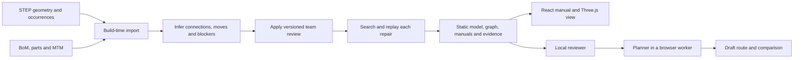

# Software Design Plan

**ReStart 0.1.0 · Product circularity · LEGO Technic helicopter 30465**

A mechanic selects the particular piece that needs replacing, sees which parts obstruct it, and follows an animated manual through removal, replacement, restoration, and a function check. The presenter can select **any of the 70 physical pieces**, including an internal gear or one of several identical pins. The release needs a replayable repair for every instance and hands-on evidence for three representative repairs.

The product loop is the reason to minimize disassembly. A successful repair returns a functioning assembly to service and documents which healthy pieces and functional units it preserves. A hosted URL serves the mechanic on Windows without installation and supports development and use on macOS. The team reviews this one helicopter before the demo. [Siemens challenge brief](../../../assets/siemens-provided/OnePager.pdf) · [Implementation handoff](02-software-design-implementation-plan.md) · [Verification and acceptance](03-software-verification-plan.md)

## Product decisions

| Decision | Behavior in 0.1.0 |
|---|---|
| Repair objective | Minimize the number of **distinct non-target pieces disturbed** over the repair. Count each healthy piece in a detached module and an axle moved only partway. Measure displacement relative to the installed assembly, so turning the whole helicopter in one's hands adds zero. Use comparable estimated disassembly times to break a count tie. |
| Damage assumption | Assume a like-for-like spare and nominal extraction geometry. A damaged tooth may still clear its normal path. A deformed or jammed part requires a different reviewed procedure. |
| Tools | Support fingers, a Technic-compatible brick separator, and an ordinary spare LEGO axle or pin used as a pusher. Each operation names its tool, approach side, and required access. Identify the particular tools used at the bench. |
| Mechanic | Show one recommended action at a time. The mechanic confirms completion. Watching an animation, orbiting the view, or inspecting a previous page leaves the confirmed assembly state intact. |
| Reviewer | Inspect the entire dependency graph, review evidence, accept or reject a candidate, add a missing blocker, and preview the changed repair. Save drafts locally and import/export JSON. |
| Delivery | Serve precomputed geometry, graph, and manuals from a static HTTPS site. Use the same TypeScript planner in a browser worker for local review. The published demo works without a model service, CAD installation, sign-in, or STEP upload. |
| Evidence | Distinguish generation, team review, constraint replay, minimum under the reviewed model, and a successful physical repair. Each answers a different question. |

## Evidence in the supplied assembly

| Input inspected | Consequence for the design |
|---|---|
| SolidWorks STEP AP203, approximately 6.9 MB | One root, 13 assembly definitions including the root, 31 distinct leaf definitions, 81 usage records, and **70 expanded leaf occurrences**. The path of usage IDs from the root identifies a physical piece within this revision. [Source STEP](../../../assets/lego-helicopter-30465-1.snapshot.9/STEP%20File%20Assembly%20-%20Lego%20Helicopter%20-%2030465.STEP) |
| Bill of materials | 70 component rows include hierarchy, occurrence-like names, mass, and functional-unit hints. All 70 “Contacts / Nearby” entries are dashes. Fourteen hierarchy strings occur more than once. Use geometry, placements, and review to establish relationships. [Helicopter BoM](../../../assets/siemens-provided/BoM_Helicopter_LEGO.xlsx) |
| Parts list | 31 inventory rows sum to 70 pieces. Element ID, design number, color, and CAD name support search and callouts. Use the part-row color field. The separate legend maps colors to hypothetical materials for the challenge. Render thumbnails from the 3D model. [Components workbook](../../../assets/siemens-provided/Components.xlsx) |
| Timing lookup | English and German sheets share row IDs. They describe connection classes, fit, mapping quality, and fictitious MTM-based times. Preserve the selected row and the rationale for applying a joining-time proxy to a removal. [Siemens timing workbook](../../../assets/siemens-provided/MTM_Mapping_Connection_V3.xlsx) |
| Illustrated assembly sheet | The supplied sheet has 22 numbered build stages, direction arrows, orientation changes, and inset subassemblies. It is a visual and mechanical reference for the reviewer. A build stage alone supplies insufficient evidence that a piece blocks a repair. [Assembly sheet](../../../assets/lego-helicopter-30465-1.snapshot.9/Instructions%20-%20Lego%20Helicopter%2030465.png) |

## Architecture and design principles

Use React, TypeScript, Vite, and Three.js. Test **identity** (which physical piece), **mechanics** (which move is possible), **presentation** (what the mechanic sees), and **evidence** (why to trust this version of the route) independently. The graph, picker, mesh, part callout, and exported results all use the same occurrence ID. Domain code operates on data and millimetres. React controls navigation and confirmations. Three.js displays poses. The mechanic commits a repair step with an explicit confirmation.



Package the model, rules, and provenance as one versioned dataset. Pin the importer and record the STEP fingerprint. A future service could provide another dataset through the same loader. The hackathon ships one dataset and builds it locally or in CI. A versioned graph JSON export lets another project consume results without creating a dependency between teams.

### A UI concept Astra can redesign

Qwen delivers a working **concept gallery at `#/concept` in development** alongside the mechanic and reviewer screens. It renders the actual presentation components against named, deterministic fixtures. Include an exposed part, two identical pins, a buried target, partial withdrawal, insertion, restoration, reviewer diff, unsolved route, completion and reduced motion. Give the gallery a real miniature 3D fixture and an optional static scene slot for layout work. A designer can open any state immediately without importing CAD or stepping through a repair.

| Ownership | What crosses the boundary |
|---|---|
| `src/domain/` | Pure assembly state, graph, search, replay, metrics and evidence rules. Inputs and results are serializable. |
| `src/app/` | Loads the dataset, owns session progression, calls the planner worker and storage, and derives view models. Handles user intents such as `selectInstance`, `confirmStep`, and `previewEdit`. |
| `src/presentation/` | Typed view models and action props, screen layouts, reusable part callouts and controls, `tokens.css` and screen styles. Screens can receive a scene, graph, or inset as a replaceable visual slot. |
| `src/scene/` and `src/graph-view/` | Translate prepared scene or graph descriptions into rendering and hit tests. Emit instance or operation IDs back to the app. |
| `src/concept/` | Hosts the same screens with fixture view models and action handlers. Includes a short map from each screen to its layout, tokens, slots, and fixture states. |

Keep short-lived visual state such as an open menu in a view. Compute the next legal operation, disturbance count, evidence status, and eligibility to confirm in the app/domain. The production and concept hosts import the same views. Astra can change the page composition, typography, callouts, graph styling, or controls by editing presentation and render adapters. A replacement-shell test must complete the same domain repair with the same route fingerprint. The [implementation handoff](02-software-design-implementation-plan.md) specifies the contract and the [verification plan](03-software-verification-plan.md) exercises this separation.

### Graph meaning and source of truth

- **Contains** links the assembly, stage occurrences, and physical leaves. **Connected to** describes an interface such as an axle through a bore. **Requires** relates a particular move to the state a blocker must reach. Keep all three relationships inspectable.
- A node for a **move** carries the affected IDs, starting and ending poses, approach, tool, sweep, and inverse or separately authored insertion. A clamp or engaged pin can hinder motion even when the target has a clear line of sight. A part can also prevent the mechanic from getting a pusher behind it.
- Express alternatives as distinct move options. For a hypothetical pin, pulling left could require both A and B to move. Pushing right could require only C and access for a pusher. Draw prerequisites pointing toward the operation they enable. Label the two directions so that the full graph doesn't imply all three pieces must come off.
- A partially withdrawn axle is a named pose with an explicit travel distance and stop landmark. It may clear a gear while remaining supported in a beam. An intact module moves every member together. A target carried inside such a module still needs to be individually released before it can be swapped.
- Record where each relation came from, including occurrence paths, geometry measurements, candidate direction, connection classification where supported by the Siemens lookup, and reviewer correction. Keep the original candidate and the decision. A circular contact pattern is ordinary. A route that cannot satisfy its operation prerequisites gets a diagnostic.

### Route, restoration, and evidence

Search a finite catalog of reviewed removal and return motions. A dependency graph enables a search over assembly **states**. A topological order of every visible edge would discard choices of direction, partial movements, and intact-module moves. Seed search with a complete replayable route, then try to reduce disturbed pieces. Record whether search proved the minimum for this catalog or stopped with the best feasible route found. A successful geometry check refers to the modeled clearances, allowed contacts, and tools.

Record the moves actually confirmed. Release the damaged target individually, exchange it for an equivalent spare, insert it at the required orientation/depth, and restore the disturbed pieces. For each access move, retain a validated return move with its own tool, insertion check, and final landmark. A partial withdrawal must end at its original depth. For a rotor or drivetrain repair, the last page can ask the mechanic to turn the rotor by hand and check the expected motion established on the kit.

| Evidence shown to the user | Meaning |
|---|---|
| Replayed against model | All steps, including return, passed the recorded state and clearance checks for these model and tool revisions. |
| Minimum under reviewed moves | Search eliminated all lower-disturbance repairs permitted by this operation catalog. A capped search reports “Best route found” with its count. |
| Physically verified | A teammate completed this exact procedure uncoached, recorded tools and observations, and passed the function check. |
| Preserved intact | A reviewed functional unit kept its internal connections throughout the repair. A unit can be lifted to the bench intact while its constituent pieces count as disturbed. Distinguish this from a unit left in place. |

## Mechanic experience

The opening screen is an assembled helicopter beside a searchable illustrated inventory. Search by common name, CAD name, element ID, or design number. Group repeated pieces by type, then expand to individual instances with a location description, close-up, and stable short label. Clicking a visible mesh selects the same list row. Selecting a buried part from the list temporarily ghosts its occluders and centers it. Confirm the highlighted instance before generating its manual.

**The manual should look like a usable page from the supplied instruction sheet.** Use a light grey build field (`#E6E6E6`), white paper (`#FFFFFF`), black ink (`#172127`), a pale yellow parts inset (`#FFF2C4`), and a dark red movement arrow (`#B92324`). Preserve part colors. Give the active piece a high-contrast outline and a part callout so color is optional. Use Barlow Condensed Bold for large step numbers and Atkinson Hyperlegible Next or a system sans for instructions. Keep text and controls in the DOM. Use original renders from the matched meshes.

```text
┌─ Replace [piece and location] ───────────────  Repair graph ─┐
│  3   Remove blockers                 [part close-up]  1×     │
│                                                             │
│         Assembled helicopter in a consistent orientation    │
│         Highlighted piece · motion arrow · start outline    │
│                                                             │
│  [tool]   Push from the marked side until [stop landmark].  │
│  Replay   Orbit   Reset view             Confirm step       │
└─ Confirmed steps      Remove · Replace · Restore · Check ────┘
```

- **Orientation.** Default to an oblique, near-orthographic view. Keep a consistent nose/tail reference and show an explicit turn icon when the camera needs to move to the other side. Use a keyed inset for a pin hidden behind a beam. Drag to orbit, zoom, and return to the saved step view with a button.
- **Motion.** Show one active action with start ghost, arrow, tool contact point, and stop pose. Provide replay and pause. Keep the other pieces at their actual current poses. “Exploded view” is a labeled overview with a reversible slider for seeing part relationships. Returning to the manual restores the confirmed poses and camera. Explosion offsets never become tool paths.
- **Bench use.** A large confirmation control advances the page only after the mechanic acts. During review of a previous page, offer “Return to current step.” Show “Insert replacement,” “Reseat axle,” or the relevant action verb. Phase and step count remain visible. Keep the next action reachable at laptop, tablet, and narrow widths.
- **Accessibility.** Provide keyboard-accessible part selection and step controls, visible focus, explicit direction words referenced to the model, quantity and tool text, and a textual dependency list. Reduced motion shows start and end poses plus the arrow. Provide a retry for missing model assets and a clearly labeled text route if WebGL is unavailable.
- **Completion.** Report the replaced instance, healthy pieces disturbed, units preserved intact, estimated disassembly time with mapping coverage, and the function-check result. Measured physical time has its own label. Offer an export of the graph and a concise JSON repair report with revisions and evidence.

## Reviewer experience

Provide a separate `#/review` page. Show a collapsible occurrence hierarchy, a dependency graph, and a synchronized 3D selection. Make the complete assembly browsable and offer a target-focused view with the selected route emphasized. Each option can reveal the direction, blocker pose, connection, tool approach, evidence and alternatives. Use React Flow and Dagre for a flat layered layout of the current dependency view, with a separate hierarchy tree for navigation. [React Flow layout guidance](https://reactflow.dev/learn/layouting/layouting)

A reviewer selects a specific move, adds a missing blocker and required clearance state, gives a reason, and previews the difference. Show steps added/removed, disturbed-piece and time changes, and an explanation if no route survives. Accept/reject candidate relations through the same workflow. A draft may contain an unsolved repair. Show it as such and keep the published baseline available. Persist the edit set locally under its dataset revision. JSON round-trip supports handoff to the team. The build promotes reviewed edits into a new published bundle.

Bind each physical record to the procedure it exercised. A change to a motion, selected ID, order, depth, tool, return instruction, relevant clearance assumption, or function check requires fresh hands-on evidence for that route. A timing-label edit alone can leave that record valid. Recompute the model check after constraint edits and compare actual resulting routes across all 70 instances.

## Library choices

| Candidate | What it actually provides | Decision |
|---|---|---|
| buildinginstructions.js | Three.js browser instruction viewer for authored LDraw steps, with parts callouts, previews and step editing examples. | Use its web manual to study framing and navigation. Integrating it would require a STEP occurrence-to-LDraw crosswalk and a second step representation. [Project and samples](https://github.com/LasseD/buildinginstructions.js) |
| TNTViewer | Browser animation of LDraw construction steps with playback, speed, pause and step controls. | Reference for animation controls. ReStart needs extraction paths and tool access generated from its own repair graph. [Project](https://github.com/yomboprime/TNTViewer) |
| LPub3D | Desktop LDraw instruction authoring with PDF/image output and an HTML parts list. | Reference for page composition and subassembly insets. The deliverable is an interactive web manual. [Official output formats](https://trevorsandy.github.io/lpub3d/) |
| occt-import-js and glTF Transform | OpenCascade-based STEP tessellation usable from Node, plus binary glTF writing. | Run at build time. Export pickable instance nodes with stable IDs. [Importer](https://github.com/kovacsv/occt-import-js) · [NodeIO](https://gltf-transform.dev/modules/core/classes/NodeIO) |
| Three.js | GLB loading, object picking, animation and a WebXR renderer. | Use a single scene adapter shared by desktop and headset. Build the LEGO-style page in React around it. [GLTFLoader](https://threejs.org/docs/pages/GLTFLoader.html) · [WebXRManager](https://threejs.org/docs/pages/WebXRManager.html) |

## Product-loop assessment and transfer

Explain the recommendation in terms the mechanic can check. For a completed repair, report “Replace [target]. Retain [verified unit] intact.” Show the count and effort that support it. Cite the operations and timing rows behind an estimate. Report missing mappings explicitly. Show costs or monetary recovery values only when an identified input supplies them.

Include a worked transfer example for the judges. In a hypothetical serviceable equipment enclosure, a cover is an occurrence, its fasteners are connections, tool access is a prerequisite, and a removable fan cartridge is a functional unit. The same graph could describe replacing the cartridge while preserving the housing. A real device would need its own CAD, service constraints, return checks, and qualified validation. This example illustrates the data mapping and product-loop decision.

## Stretch goals and boundaries

1. **Quest 3 digital twin.** From the hosted page, enter immersive mode and place an enlarged model beside the real kit. Highlight the one piece and tool direction for the active step. A controller confirmation advances the same session used on desktop. An early headset trial with adjacent identical pins tests whether the cue identifies the correct piece. Manually aligned passthrough on a stationary kit is a later experiment. A spatial anchor fixes a position in the room, so moving the kit requires realignment. [Meta WebXR overview](https://developers.meta.com/vr/documentation/web/webxr-overview/) · [Meta mixed-reality sample](https://developers.meta.com/vr/documentation/web/web-sample-realmeasure/)
2. **Multiple broken pieces.** Search one repair with a set of target instances. Reuse an open access path and swap every target before closing it. Exclude all target instances from the disturbance count. Verify that two targets behind the same beam move that beam only once.
3. **Natural-language selection.** An external model service or locally served Qwen3.8-Flash-Next ranks IDs from the loaded inventory. Highlight candidates and have the presenter confirm the exact occurrence. Keep the standard picker available.
4. **Automated graph generation.** Begin with a small development-time AI connection-classification evaluation against team labels. The stretch loop extends this to model-proposed operations, directional blockers and partial strokes. Run an independent simulator for contact, sweep, grip/tool access, support, and restoration. Return specific counterexamples for revision. Performance on held-out interfaces and physically checked repairs establishes how useful the loop is. Geometry-based clearance proxies describe modeled access. A person at the kit checks whether they can perform the movement.
